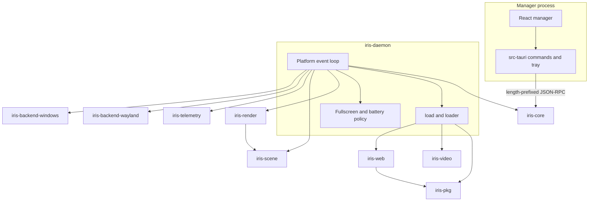

# Architecture

Iris is two processes. `iris-daemon` owns monitors, decoding, and presentation.
The Tauri app is a tray manager and an IPC client. The manager never opens a
Wayland surface or a wgpu device.

## Process boundary

| Process | Owns | Must not own |
| --- | --- | --- |
| `iris-daemon` | Sockets or pipes, wallpaper slots, GPU surfaces, video decode, webviews, telemetry sampling | The React UI |
| `iris` (Tauri) | Tray, window, IPC client, package inspection for the library | Wayland, wgpu, FFmpeg, WorkerW |

Closing the manager hides the window. The daemon keeps presenting. Quit
Manager exits the tray process and leaves the daemon running. Stop Wallpaper
clears every assignment. The `shutdown` IPC method still exists; the tray
does not send it.

## Crates

| Crate | Role |
| --- | --- |
| `iris-core` | JSON-RPC types, frame codec, daemon config, logging. `forbid(unsafe_code)`. |
| `iris-pkg` | `.pkg` archives, `.tex` mipmaps, `scene.json`, `project.json`. |
| `iris-render` | One shared `wgpu` 23 device and a surface per output. Still-image, YUV, and scene draws. |
| `iris-backend-wayland` | `zwlr_layer_shell_v1` background layers and a `calloop` pump. Linux only. |
| `iris-backend-windows` | WorkerW reparenting, monitor enumeration, `PeekMessageW`, WASAPI loopback. |
| `iris-video` | VA-API, then NVDEC, then a software FFmpeg decoder. Linux only. Planes are copied on the CPU. |
| `iris-scene` | Parented layers, particle instances, lock-free FFT. Capture uses cpal except on Windows, where WASAPI pushes samples. |
| `iris-telemetry` | 500 ms CPU, memory, network, and battery sampler. Fullscreen probe for Sway and Win32. |
| `iris-web` | `wry` webview, `iris://` asset protocol, Wallpaper Engine JavaScript shim. |
| `iris-daemon` | IPC server and the platform frame loop. |
| `src-tauri` | Manager shell. Edition 2024. Every other crate is edition 2021. |

`cargo test` builds the default members and skips `src-tauri`, so the engine
suite does not need WebKitGTK. `cargo test --workspace` builds the manager too.

## Frame path

On Linux the compositor drives presentation. Each layer requests
`wl_surface.frame`. The callback draws, commits, and queues the next frame.
When a slot is paused the callback returns without queuing another frame.
Resume kicks the layer if it is idle. A 500 ms calloop timer applies fullscreen
policy after frames have stopped. The webview has its own 16 ms timer and does
not replace the GPU clock.

On Windows the daemon thread wakes about every 16 ms, drains `PeekMessageW`,
applies policy, and presents. The webview is a child of a borderless window.
Its HWND is reparented with `embed_window` onto the WorkerW behind the desktop
icons.

A GPU surface is dropped before the layer role or the HWND that created it.
wgpu 23 `Device` and `Queue` are `Arc`, shared across outputs.

## Slots

A still image, a scene, or a Linux video file becomes a GPU slot. A web
wallpaper does not. `loader` classifies `type: web` and a bare `index.html`
before the GPU loader runs, and the daemon stores those instances beside the
GPU slots. Status, pause, resume, clear, and pointer updates cover both.

One output has one active wallpaper. Applying a web project removes the GPU
slot on that output, and applying a GPU wallpaper removes the webview.

## Uniforms

Still images use a 112-byte uniform block in `shader.rs`.

Scene draws pack a 344-byte `SceneUniforms` prefix by hand, then telemetry.
`FRAME_UNIFORM_SIZE` is 552. The shader reads the block as a storage binding
so the array stride stays 4. WGSL padding uses scalar floats. A `vec3` would
insert alignment the packer does not write. The vertex shader references
telemetry so naga keeps the helper. Do not regenerate this layout with a derive
that inserts padding.

## Failure isolation

A bad wallpaper fails that slot and returns an IPC error. It does not exit the
daemon. A webview that cannot start is logged, retried once with software
rasterization (`WEBKIT_DISABLE_COMPOSITING_MODE` on Linux,
`--disable-gpu` on WebView2), and then left as a failed slot. A missing
Wayland session or an empty monitor list logs a warning and, for a web
wallpaper, opens a virtual 1920×1080 placement instead of aborting the process.

Video that cannot use VA-API or NVDEC decodes in software. The first telemetry
CPU sample is zero until the sampler has a second reading. A missing battery
is reported as AC at full charge.

## What this tree does not do

- macOS presentation.
- DMA-BUF or zero-copy video import. Frames are CPU planes, then `write_texture`.
- Glyph atlases. Scene text is a tinted quad.
- A config file for the daemon. `DaemonConfig::default()` is what `iris-daemon`
  serves. Tests pass a config into `run_with`.
- Reading `RUST_LOG`. The subscriber uses the config filter, which defaults to
  `info`, and writes stderr.
